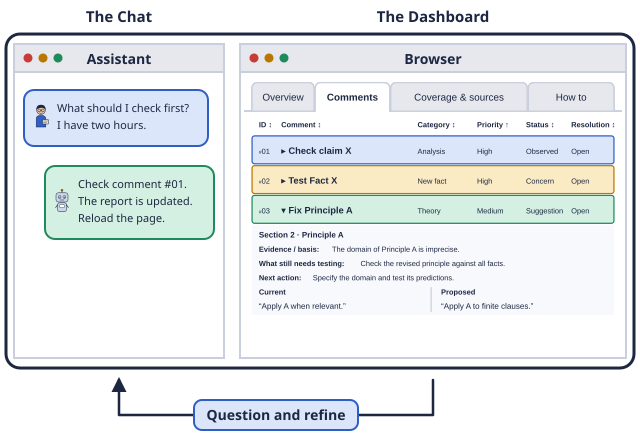

# LingRev

Review your paper with an AI assistant. Get feedback, inspect its evidence, and choose what to revise.

**[Introduction](https://ai-for-linguistics.github.io/lingrev/)** · **[Download the kit](https://ai-for-linguistics.github.io/lingrev/lingrev-beta.zip)**

## Start

1. Download and unzip the kit.
2. Give your AI assistant the [review prompt](PROMPT.md) and your paper. Add literature, code, or data if useful.
3. Open the generated dashboard beside the chat. Ask for checks, rewrites, new analyses, or changes to the report.

Use an assistant that can read and write files and run commands. Its usual credits or API costs apply. Review your own work, share material only when permitted, and check AI feedback before using it.

[Guide](docs/guide.md) · [Example review](https://ai-for-linguistics.github.io/lingrev/example.html) · [Contributing](CONTRIBUTING.md) · [MIT license](LICENSE)
