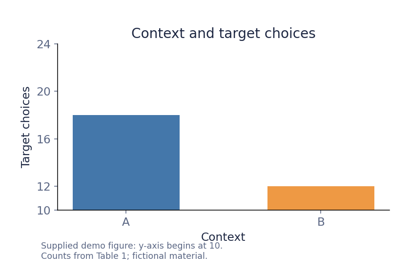

# Demonstration manuscript: context and interpretation

Version: demo-2. This deliberately abbreviated fictional manuscript supplies the evidence for the example dashboard. It contains no real participants or empirical findings.

## 1. Question

We investigate whether context affects the interpretation of a target sentence. We compare responses in two contexts, A and B.

## 2. Method

Twenty-four participants judged the target sentence in each context. We recorded whether they selected the target interpretation. The same participants saw both contexts.

## 3. Results

Table 1. Counts of participants selecting the target interpretation.

| Context | Target interpretation | Total |
| --- | ---: | ---: |
| A | 18 | 24 |
| B | 12 | 24 |

The target interpretation occurred in 75% of responses in context A and 60% in context B. This difference proves that context A forces the target interpretation.

Figure 1. Target choices by context. The displayed y-axis ranges from 10 to 24 target choices.

## 4. Discussion

Our results demonstrates that the target interpretation is obligatory in context A.
